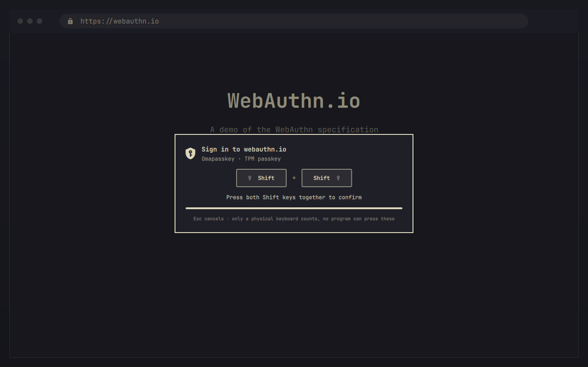

# Omapasskey

Passkeys for [Omarchy](https://omarchy.org), the way Windows Hello and macOS do them.

Firefox, Chromium and every other FIDO2 client store passkeys **on this computer, inside its TPM chip**. No phone, no USB key, no cloud account. Every use needs your PIN **and both Shift keys pressed on a real keyboard**, so no program and no AI agent running on your machine can sign in for you.



## What you get

| | |
|---|---|
| Passkeys on the device | Register and sign in on any site that supports passkeys or security keys: GitHub, Google, Microsoft, Bitwarden, webauthn.io … |
| Keys that never leave the TPM | Every private key is generated by the TPM, marked non-exportable, and stored only as a TPM-wrapped blob that is useless on any other machine. |
| PIN unlocks the TPM | The PIN is not compared by software: it is the TPM's authorization for the master secret, and the TPM's own anti-hammering blocks guessing — even for root once the TPM's lockout has a password (`sudo omapasskey tpm protect`). |
| Agent-proof confirmation | Every use waits for Left Shift + Right Shift on a **physical** keyboard. Keystrokes made by software (ydotool, wtype, remote desktop, `/dev/uinput`) are ignored by design. |
| A themed prompt | Shows which site asks and why, dims the screen, counts down. Esc cancels. |
| Usernameless sign-in | Discoverable credentials with account picker, PRF / `hmac-secret` (passkey encryption, e.g. Bitwarden unlock), `credProtect`. |
| Works with browser tools | Firefox `about:webauthn` and Chromium `chrome://settings/securityKeys` list and delete passkeys and change the PIN. |
| Locked-down service | Unprivileged user, no capabilities, no network, seccomp filter, read-only system: `systemd-analyze security` rates it **0.7 SAFE**. |

## How it works

```
 Firefox / Chromium / libfido2
          │  CTAP 2.1 over HID (exactly like a YubiKey)
          ▼
 /dev/hidrawN ◄── virtual USB security key (kernel uhid) ──┐
                                                           │
 omapasskeyd  (system service, user "omapasskey", sandboxed)
   ├─ TPM 2.0 ── keys created, used and kept inside the chip
   ├─ physical keyboards ── Left Shift + Right Shift = "touch"
   └─ /run/omapasskey/status.sock ── read-only events ──► Omarchy bar + prompt
```

Browsers on Linux have no operating-system passkey API to call, but they all speak to USB security keys. Omapasskey is one — a virtual one whose secure element is your TPM. That is why it works in every browser without extensions and why the browser shows its own PIN dialog.

**One sign-in, step by step:** the site asks for a passkey → the browser asks for your PIN → Omapasskey shows *Sign in to github.com — press both Shift keys* → you press them → the TPM releases the master secret for this one ceremony, signs, and the secret is wiped.

## Install

You need Omarchy 4, a TPM 2.0 (any recent laptop or desktop; enable fTPM/PTT in the firmware if `/dev/tpmrm0` is missing) and systemd 254 or newer.

```bash
omarchy plugin add https://github.com/Divanyx/omapasskey --enable
```

A shield appears in the bar with a red dot. Click it: a terminal opens, shows what will be installed, asks for your password (sudo) and then for the passkey PIN you want. That is all.

The terminal runs [`setup/omapasskey-setup install`](setup/omapasskey-setup), which downloads the two release binaries and checks them against the SHA-256 sums pinned in this repository before anything is installed. Prefer to build yourself? `setup/omapasskey-setup install --from-source` (needs Go) builds from the checkout and tells you whether your build matches the published one bit for bit.

Then try it on [webauthn.io](https://webauthn.io): register, sign in.

## Use

- **Register a passkey:** on a site's security settings choose *Add a passkey* or *Add a security key*. Firefox and Chromium ask for your PIN, Omapasskey asks for both Shift keys.
- **Sign in:** choose *Sign in with a passkey*. Several accounts on the same site? The browser shows a picker.
- **Manage passkeys:** right click the bar icon. Enter your PIN, press the confirm keys, and you see every passkey stored here — hover one for its details (account, created, kind, PRF, protection), delete it with the trash icon (asks again, and needs the keys again). The panel forgets the PIN and the list when it closes or after five idle minutes, and cancels a request that is still waiting for the keys. (QML strings cannot be overwritten in memory, so "forgets" means dropped, not wiped.) A browser that needs the keys meanwhile takes precedence over the panel.
- **Bar icon:** left click shows status, a health check, setup or repair; middle click changes the PIN; right click opens the manager.
- **Choose the confirm keys:** both Shift keys by default. In the plugin settings (*Keys that confirm a passkey use*) or with `sudo omapasskey keys set leftctrl+rightctrl` pick 2–4 keys, e.g. `leftalt+space`, `rightctrl+f12`. The choice lives in the root-owned service config, so software cannot change it; the plugin opens a sudo terminal to apply it.
- **Command line:**

  ```bash
  omapasskey status          # service, PIN, keyboards
  omapasskey doctor          # checks the whole chain
  omapasskey watch           # follow prompts live
  sudo omapasskey list       # all stored passkeys (asks for the PIN)
  sudo omapasskey delete ID  # remove one
  sudo omapasskey pin change
  sudo omapasskey reset      # erase PIN and all passkeys
  omapasskey keys            # show the confirm keys
  sudo omapasskey keys set leftctrl+rightctrl
  ```

## Security model

**Protected against:**

- **Programs and AI agents running as you.** They can talk to the virtual key like any browser can, but every operation that uses a key needs a press of both Shift keys on a keyboard that is real hardware. Omapasskey reads those keys itself, from `/dev/input`, and only from devices that sysfs places on a physical bus; uinput, uhid and Wayland virtual keyboards cannot produce them. Agents also cannot burn your PIN retries: the key press comes *before* the PIN is checked. Tested: [`tests/agentproof`](tests/agentproof) holds both Shift keys on a fake "Logitech USB Keyboard" — the release build times out, every time.
- **Copying your passkeys.** Private keys are created inside the TPM with `fixedTPM | fixedParent`; nothing, root included, can export them. A stolen disk image or backup is worthless without this exact TPM.
- **Reading your passkey list.** Site names and account names are encrypted (AES-256-GCM) under a key that only the PIN unlocks. Even root sees only opaque blobs.
- **Guessing the PIN.** Every wrong guess counts against the TPM's dictionary-attack lockout, and after 8 wrong PINs in a row the PIN is blocked for good (only a reset, which erases the passkeys, helps). Since every attempt needs a key press, nobody but you can use those tries up. Against **root** the TPM lockout holds only if the TPM's lockout authorization is set: many TPMs ship with it empty, and then root can reset the counter and keep guessing. `omapasskey doctor` tells you; `sudo omapasskey tpm protect` sets a random lockout password and shows it once as a recovery code. A long PIN with letters helps either way.
- **Silent use.** Assertions without user presence ("silent" probes) never carry a valid signature unless the PIN was given, so no request can be turned into a login behind your back.
- **A compromised plugin.** The bar plugin runs inside the Omarchy shell and only *reads* a status stream. It cannot approve anything; it can only display.

**Not protected against** (and no software passkey on any desktop OS is):

- **Root or a compromised kernel at the moment you sign in.** Root cannot extract keys or use them without your PIN, but it can watch you type the PIN and then use the TPM itself. Note: membership in the `docker` group is root access.
- **Someone at your unlocked computer who knows your PIN.** Lock your screen.
- **A malicious prompt.** Software running as you could display a fake prompt that names a different site. Check that the site in the prompt matches the page you are on — the browser's own dialog shows it too.

**Lost TPM = lost passkeys.** Clearing the TPM in the firmware, some firmware updates, replacing the mainboard or reinstalling with a TPM reset makes every passkey stored here unusable. That is the price of keys that cannot be copied. Always keep a second sign-in method for every account: another passkey (phone, hardware key) or recovery codes.

See [SECURITY.md](SECURITY.md) for the key hierarchy and how to report a vulnerability.

## Compatibility

- **Firefox** — verified end to end with Firefox 158 (registration, usernameless sign-in, PRF, allow-list sign-in), including its preflight requests.
- **Chromium/Chrome** — speaks the same CTAP 2.1, verified with python-fido2's browser-equivalent client. Chromium may ask you to "touch" the key before it asks for the PIN; that Shift press also covers the PIN step.
- **libfido2 tools** (`fido2-token`, `ssh-keygen -t ecdsa-sk`) — standard FIDO2, untested so far.
- **Keyboards** — built-in, USB and classic Bluetooth keyboards confirm. Bluetooth LE keyboards are uhid devices like software keyboards and cannot.

## Uninstall

```bash
~/.config/omarchy/plugins/omapasskey/setup/omapasskey-setup uninstall   # service only, passkeys kept
~/.config/omarchy/plugins/omapasskey/setup/omapasskey-setup uninstall --purge   # also erase all passkeys
omarchy plugin remove omapasskey
```

Remove the passkeys from the sites' security settings too.

## Verify the binaries

Release binaries are reproducible. For every tag, CI rebuilds them from source and refuses to publish unless they match [`setup/SHA256SUMS`](setup/SHA256SUMS); each release also carries a signed build-provenance attestation:

```bash
gh attestation verify omapasskeyd-linux-amd64 --repo Divanyx/omapasskey
./scripts/build-release.sh   # with Go 1.27.1: same SHA-256 sums
```

## Development

```bash
CGO_ENABLED=1 go test -race ./...    # unit tests against the TPM reference simulator
```

The integration tests drive a running test build (`-tags omapasskey_testpresence`, which simulates the key press and never ships) through Yubico's [python-fido2](https://github.com/Yubico/python-fido2) as client and WebAuthn server, and through a real headless Firefox: [`tests/integration`](tests/integration).

Implementation notes: Go, [go-tpm](https://github.com/google/go-tpm) and [fxamacker/cbor](https://github.com/fxamacker/cbor) as the only dependencies; CTAP 2.1 with PIN/UV auth protocols 1 and 2, `alwaysUv`, credential management, `hmac-secret`, `credProtect`; packed self-attestation; AAGUID `2bfb6aa2-0b2f-4a8c-9e2a-6f6d61706b79`.

## License

[MIT](LICENSE)
